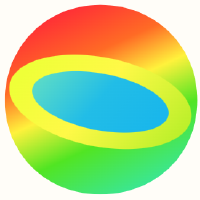

#  eyelit

[](https://doi.org/10.5281/zenodo.23824021)
[](https://www.npmjs.com/package/eyelit)

eyelit is a **JavaScript rule language** with forward and backward reasoning
and checkable proofs. You write facts and rules in plain JavaScript; eyelit
draws conclusions, and every conclusion can come with a proof that a separate
checker verifies against your program. It runs as a command-line program, a
JavaScript library, and a browser application, with no dependencies.

- **[Playground](https://eyereasoner.github.io/eyelit/playground)**: run
  programs in your browser.
- **[Guide](https://eyereasoner.github.io/eyelit/GUIDE)**: run programs,
  write rules, check proofs, use the library, and develop eyelit.
- **[Specification](https://eyereasoner.github.io/eyelit/SPEC)**: the
  language, its canonical text, the proof format, and the C1–C7 checks.
- **[Examples](examples/)**: 63 runnable programs, with their conclusions,
  proofs and check reports, and a
  [card deck](https://eyereasoner.github.io/eyelit/examples/deck/) for each.
- **[Conformance suite](conformance/)**: 321 cases that test any
  implementation of the specification through its command line.

```js
fact(type('socrates', 'human'))
fact(subclass_of('human', 'mortal'))
implies([type(S, A), subclass_of(A, B)], type(S, B))
query(type(X, Y))
```

```sh
node bin/eyelit.js examples/socrates.js
node bin/eyelit.js --proof examples/socrates.js > /tmp/proof.js
node bin/eyelit.js --check-proof /tmp/proof.js examples/socrates.js
```

MIT licensed; see [LICENSE.md](LICENSE.md).
